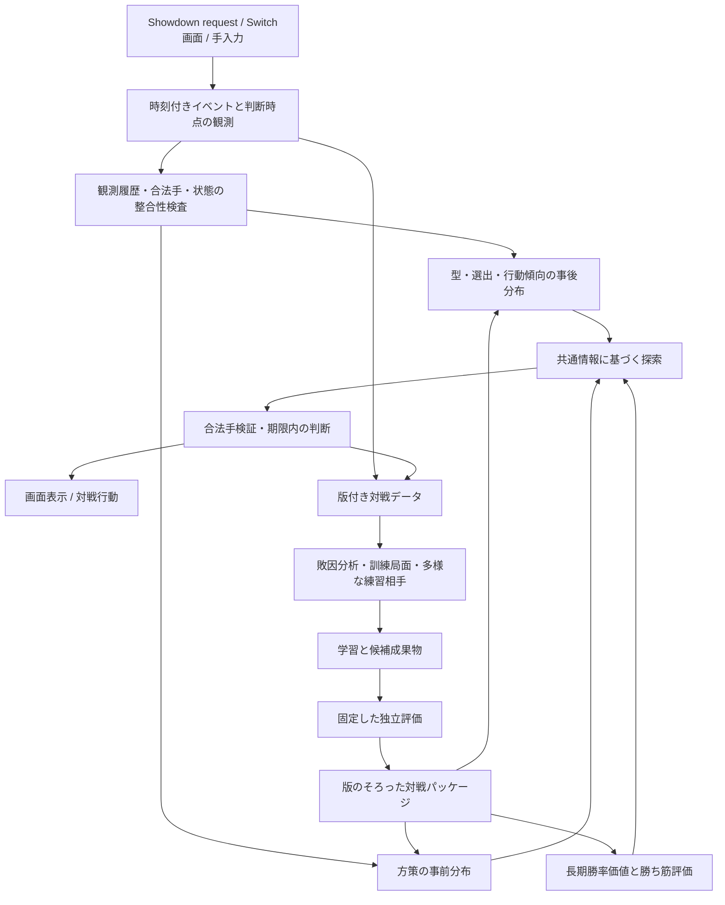

# 対人戦の判断品質を改善する実装設計

作成日: 2026-10-15。コード調査の基準: `270530c`。

対象は既存の Champions シングル対戦支援・Showdown 対戦・学習基盤。ユーザー提供の 10/15 01:10 の報告を出発点に、現行コードを調査して設計した。本書は提案であり、改善効果を実測した報告ではない。数値目標・計算予算は初期案として区別する。

## 1. 結論と対策の優先順位

抜本的な対策は、**「特定の AI に勝つ方策の確率を信じる」構成から、「観測履歴に整合する複数の相手・展開で、勝ち筋を維持する意思決定を学習・検証する」構成へ移行すること**である。

現在の問題は入力特徴だけでは説明できない。学習する対戦の偏り、先読みの継続方策と評価尺度、情報漏洩を含み得るデータ再構成、学習・評価・選出モデルの不一致が重なっている。PPO の再学習を先に繰り返すと、改善していないものを改善したと判断する危険が残る。

順序は以下とする。

1. **観測と評価を信用できる状態にする。** 判断時点の情報を固定し、状態復元を本物のシミュレータと比較する。学習・調整・最終評価のデータを分離する。
2. **既存モデルのままで致命的な取りこぼしを減らす。** 強制交代の探索、誤った状態の検知、選出モデルの版管理、攻撃役の保存、例外時の合法手への復帰を導入する。
3. **先読みを作り替える。** 型ごとに別の最適手を選んで平均する方式をやめ、共通の情報に基づく手を比較する。相手の行動予測を手の評価にも使い、交代・妨害・メガ・積みを含む継続方策と長期価値で評価する。
4. **実戦の失敗を練習環境へ戻す。** 人間の真似だけに頼らず、妨害を使う相手、こちらの弱点を突く相手、多様な過去方策を組み合わせる。
5. **構築と選出の上限も検証する。** ペンドラーの操作改善、ペンドラーを含まない選出、合法な攻撃技を持つ型・代替構築を同じ条件で比較する。

最初の成果は「対人勝率が上がった」という主張ではなく、既知の敗因を再現でき、その原因を除去したことを確かめられる基盤とする。対人勝率はその後の独立した検証で判断する。

## 2. 現状の根拠と、まだ断定できないこと

### 2.1 提供された実戦報告

| 報告 | 解釈 | 留保 |
|---|---|---|
| 今夜 33勝46敗、約42% | 現状の対象環境では勝ち越せていない | 単純な独立試行を仮定した95% Wilson区間は約32〜53%。時間帯・同一相手の繰り返しを考えると独立性も要確認 |
| レート1200以上に7勝15敗 | 強い相手への弱さの仮説 | 同区間は約16〜53%。22戦で原因や差の大きさを確定できない |
| 特徴追加後も大悪手率5〜7% | 入力追加だけでは既存教師上の改善が見えない | 教師も現行探索なので、探索が見落とす長期的悪手は測れていない |
| 統合方式変更で5.4%→2.8% | 現行探索との不一致は減った | 独立した「正解」への改善とは限らず、選出・構築・対人勝率の改善も未証明 |
| 推定60〜80%の試合で実勝率32% | 表示値の意味または較正に問題 | 予測を採った時点、対象試合数、使用版、同一試合の重複を確認する |
| ペンドラー選出時の17敗中8敗が最後の1体 | 勝ち筋の保存が重要 | 8/17は「敗戦中の割合」。全選出試合での発生率と、勝った場合も集計する |
| ブラッキー/ペンドラー/フラエッテが2勝9敗 | 要診断の選出 | 同区間は約5〜48%。11戦だけで恒久禁止にしない |

109試合（Showdown86、Switch23）は報告時点の統合数として扱う。調査時のファイル数は Showdown86、live16、映像再構成22、一般リプレイ4,999。live と再構成には重複があり、ファイル数の足し算は試合数ではない。一般リプレイも4,999件すべてが人間・同じ対象分布と確認されたわけではない。

### 2.2 コードから確認した構造上の課題

| 箇所 | 現行の挙動 | 設計への影響 |
|---|---|---|
| `services/sim-tools/lookahead.js::greedy` | 継続では自主交代を選ばず、メガ付き技を比較対象から外し、変化技の直接スコアは0 | 深さを増やしても妨害・積み・回復・読み合いの価値は保証されない |
| 同 `evaluate` | 最初の同時行動に続き、`rollout=3` の追加継続を実行 | 「3ターン」という説明と実際の処理回数を分ける。通常進行では初手＋追加3ターンで、交代要求も別に処理される |
| 同 `score` | 両者の残HP割合の差＋終局ボーナス。勝利の速さも加点に影響 | 攻撃できないHP満タンの1体を過大評価し得る。最終目的の勝敗と尺度をそろえる |
| 同 `setUp` | 新規試合を開始し、HP・状態を後から書き戻す | PP、状態の経過、消費済み道具、登場時効果などの整合性を監査する必要がある |
| 同 `evaluate` の例外処理 | 不正な組み合わせ等の例外を「進展なし」として採点し得る | シミュレーション失敗を有効な評価として混ぜない |
| `search/lookahead.py::aggregate` | 各型サンプルで均衡を解き、その自分側分布・価値を平均 | 知らない型に応じて別の手を選べる前提が混ざる。平均した手がどの型にも安全とは限らない |
| `live/advisor.py::advise` | 相手BC予測との混合は、自分の手を `combine` した後に実施 | 良くした相手予測が自分の行動評価に直接反映されない |
| 同 `_policy` | PPOの報酬価値を `(value / victory + 1) / 2` で勝率へ変換 | 報酬はHP・ひんしの加点と割引を含むため、真の勝率変換ではない |
| 同 `can_search` | `battle.force_switch` では探索しない | ひんし後やバトンタッチ後の交代先は方策単独。勝ち筋を失う重要局面を取りこぼす |
| `rl/human.py::decisions` | 自分の行動ログが現れる直前の状態から学習行を生成 | 相手が先に動いたターンでは、その相手行動や被ダメージが入力に入る可能性がある |
| 同 `honest_mask` / `Sides.sets` | 試合全体で使われた技を利用し、未使用の補完技をマスク | 自分が知っていた手札の再構成と、相手予測で利用可能な情報が混在。実行時と学習時の候補分布も変わる |
| 同 `build` | 勝敗不明をreturn=0にする | 不明を中立な結果として価値学習してしまう。結果ラベルのマスクが必要 |
| `scripts/eval_records.py::query` | 当該試合以外の全試合から観測型を作る | 当該試合より後の試合を含み得る。「その時点で既知」の評価にはならない |
| `rl/teacher.py::build` | 既定の全体観測型を読み、既存探索を教師にする | 評価試合や未来の型が事前分布へ入る可能性。評価として独立していない |
| `live/session.py::_active_moves` | 技固定・かなしばりを独自に復元するが、技固定の最後の技探索に交代境界がない | スイッチ後の固定解除などを差分テストで確認する必要がある |
| `live/observed.py::load_records` | 時刻差15分以内・共通種族4体以上で重複排除 | 同じ構築と短時間に再戦した別試合を落とす可能性がある |
| `scripts/sim_matchups.py` | 方策単独と特定heuristicで選出表を生成。選出表には方策版がない | 実運用のAdvisorと評価する操作者が違い、更新後の互換性も判定できない |
| `scripts/ladder.py::choose_move` | 推薦分布の最上位の合法手を毎回選ぶ | 均衡が意図したランダム化が失われる。検索分布が90%でも「正解の確信90%」ではない |

ここでの指摘は静的調査に基づく。各項目が何敗を説明するかは、後述の再現試験で測る。

### 2.3 根本原因の扱い

「AIとの練習しかないから」は有力な仮説だが、それだけで確定しない。既存の `train_opponent.py` にはBC初期化の対抗学習、`train.py` にはリーグ・探索相手の選択肢が既にある。追加すべきなのは同じ仕組みの再実装ではなく、**妨害の頻度・練習局面の到達率・独立相手への汎化を測って相手集合を更新する制御**である。

ほかにも、観測/シミュレータ不一致、長期評価の欠如、選出表の操作者不一致、攻撃役の少ない構築、相手分布の違いがあり得る。これらを切り分ける比較実験を必須にする。

## 3. 新しい全体構成



方策は探索候補の優先順位や継続に使う。検索結果と方策確率を足す/掛ける操作を意思決定の中心にしない。状態が足りないときは「不明」を保持し、あり得る状態を分岐させる。学習・探索・選出・表示は同じ観測契約と対戦パッケージを使う。

## 4. 観測契約と状態復元

### 4.1 判断時点の固定

新設する `state/observation.py` に `DecisionObservation` を置く。

```python
DecisionObservation(
    battle_id, decision_id, turn, phase, actor,
    event_cursor, own_private, public_history,
    legal_actions, uncertain_fields,
    state_schema_version, mechanics_version, state_hash,
)
```

`phase` は `preview`、`turn_start`、`forced_switch`、`pivot_switch` を区別する。通常ターンの自分と相手の手は、**双方の行動公開より前の同じ時点**へ紐付ける。相手の技が失敗した、先に相手が動いて被弾した、メガした等の結果を当該ターンの入力へ入れない。

後攻のとんぼがえり後に選ぶ交代先など、途中で新しい情報が合法に見える判断は別の `decision_id` を作る。強制交代は「ログに後からswitchがあった」というだけで判定せず、ひんし・交代技・requestの段階から決める。

Showdownでは受け取ったrequest、合法手、入力した選択を判断時に保存する。Switchではコマンド画面・交代画面の検出とイベント境界を保存し、後から判定不能な局面は `decision_quality=uncertain` とする。過去ログを正確に再構成できない場合は除外理由を記録し、黙って「確定した観測」にしない。

### 4.2 共有状態と、シミュレータ専用状態

`BattleSession` / poke-env は入出力アダプタとして残す。共通の `ObservedBattleState` は「知っていること」を持ち、サンプルされた `SimulationWorld` は「その世界では真の値」を持つ。実行用特徴にシミュレータの隠れた真値を渡さない。

| 状態 | 保持すべき情報 | 不明時の扱い |
|---|---|---|
| 個体識別・選出 | 安定したteam slot、見せ合い6体、選出済み/未確認、ひんし | 未登場を非選出とみなさず、候補選出に含める |
| HP・PP | 自分の実数、相手の表示区間、PP使用履歴・Pressure等の観測 | 相手HPの丸めや不明PPを粒子へ反映 |
| 道具・特性・フォルム | 未判明、判明、消費/除去済み、変化後の値 | 持ち物無しと未判明を分離。メガを使えないことと石を持っていないことも分離 |
| 技の制約 | 最後の技、こだわり固定、Encore/Disableの技と経過、挑発等、拘束、PP切れ | 交代/解除の境界を適用。相手の不明な残り時間は分布 |
| 揮発状態 | 身代わりHP、守る連続回数、やどりぎのsource、のろい、滅び、バトン対象 | 有無だけでなく、効果に必要なsource・counter・durationを保持 |
| 状態異常 | 睡眠の経過、毒カウンタ等 | シミュレータ内部の未知乱数は予言せず周辺化 |
| 場・side条件 | 残りターンの範囲、延長道具の可能性、層数、Trick Room | 常に5ターン等に固定しない |
| 試合進行 | ターン数、要求段階、メガ使用権、残り時間/判定ルール | 実機とShowdownの終局条件差を別版で管理 |

`state/codec.py` と `services/sim-tools/state_codec.js` を境界にする。Node内部の状態を直接触る場所をこのアダプタへ集約する。対戦を開始してから値を上書きする処理は、開始時効果・ログ・RNG・登場回数が残らないよう隔離する。完全なシミュレータsnapshotは合成データのテスト・分岐のみに使う。

Showdown実装の状態APIに依存するため、チェックポイントにエンジンcommitとmodのハッシュを付ける。Pythonの観測スキーマ版とは別に管理する。

### 4.3 差分テストを先に作る

本物のShowdownで局面を作り、判断直前のsnapshotを正解にする。その局面を公開ログ＋その側に見えるrequestから復元し、以下を比較する。

1. 自分の合法手、要求段階、公開状態が一致する。
2. 真の型・内部状態をテスト専用に与えた場合、各合法な同時行動で次状態・HP・効果・終局が一致する。RNG状態も制御する。
3. 隠れた状態を与えない場合、真の展開を候補分布が排除しない。固定した乱数に対する完全一致は要求しない。
4. serialize/deserializeでrequest待ち、交代、消費済み道具、PP・カウンタが失われない。

最初の必須fixtureは、こだわり→交代→再登場、Disable解除、Encore残り1ターン、守る連打、滅び残り1、毒/睡眠、身代わりバトン、化けの皮、使用済みメンタルハーブ、メガ後の能力・使用権、拘束・Struggleとする。現行修正が転送している状態も、残り時間やsourceまで正しいとは仮定しない。

## 5. 対戦データと型推定の作り直し

### 5.1 単一の対戦台帳

`data/curated/battles.jsonl` と `decisions.jsonl`、再現可能な `manifest.json` を生成する。初期実装はJSONLでよい。大きなテンソルは既存NPZを維持し、必ずmanifestへ紐付ける。

対戦台帳は `battle_id`、原本のsource ID/hash、開始/終了時刻、source（Switch/Showdown/synthetic）、対象ルール、選出・構築のhash、操作者/対戦パッケージ、勝敗/引分/未完了、終了理由、相手グループ、双方の開始時レート、記録品質、原本への参照を持つ。

判断台帳は `decision_id`、観測snapshot/hash、全合法手、実際に選んだ手、選択確率、推薦分布、各手の検索値と評価件数、型事後分布の要約、探索打切り理由、所要時間、手動変更を持つ。現在の上位3〜5手と丸めた確率だけの記録では、後の比較や支持範囲の監査には不足する。

重複排除はShowdownのbattle IDを最優先し、Switchは試合セッションID・イベント列・映像時刻で確認する。曖昧な候補は統合保留へ置く。名前・近い時刻・似た構築だけで別試合を削除しない。10/14の録画欠損は明示し、存在しない映像は補完しない。ログが残っていればログで可能な分析を続ける。

勝敗不明は行動学習・観測学習に利用できるが、勝率損失ではマスクする。途中打切りを負けや引分へ自動変換しない。モデル自身のtimeout/例外による敗北は、本番運用の成績には含めて別集計もする。

### 5.2 人間・bot・不明を分離する

`opponent_kind` を `human_confirmed` / `bot_confirmed` / `unknown` とする。既知botの証拠、反復間隔、行動傾向等を記録するが、「悪へのエスパー」や構築反復だけではbotと断定しない。誤操作や人間の再戦もある。

人間行動BCの主学習は確認済み人間と、検証済みの重みを付けた不明データ。確認済みbotは別プールへ残す。評価は人間確認済み・不明・botを別々に表示し、除外前後の感度分析を添える。負けたから除外する分類は禁止する。

相手行動の学習に敗戦だけを使わない。敗因分析・訓練局面の抽出では敗戦や強い相手を厚く見るが、勝率較正・対象分布の評価は代表的な全試合で行う。勝ち相手と負け相手のレート差はマッチングの違いを示す材料であり、「勝ち試合は学べない」の根拠にはしない。

### 5.3 全処理で共通の分割を使う

| 分割 | 用途 | 使用してよいもの |
|---|---|---|
| train | BC、方策・価値学習、型事前分布、練習局面抽出 | この分割のデータと、それ以前の外部公開データ |
| development | 深さ・リスク係数・リーグ比率・候補選択 | 学習済み候補の比較。ここへ合わせたら最終評価とは呼ばない |
| calibration | 推定勝率・相手行動予測の較正 | 固定した候補の較正のみ |
| locked test | 最終比較 | 候補・係数を決めた後に一度評価 |

初期109試合では各用途に大量の独立データを割けない。開発はtrain/development内の時系列・グループ交差検証で行い、最終testは今後の試合を前向きに確保する。十分なcalibrationがない版は勝率表示を抑制する。

同一試合の両視点・原本/再構成・派生局面を必ず同じ分割にする。相手、構築の類似グループ、対戦日を跨ぐ漏洩を検査する。既知相手への将来性能と未見相手への性能は別の評価スイートを作る。相手グループで分離し切れず時系列と衝突するデータはpurgeする。

事前分布・使用率・観測型は `as_of` と `split_manifest` を受け取り、評価試合自身や未来のデータを読めないAPIにする。外部使用率も公開時点を保存する。実行時点を再現する評価と、固定事前分布で行う方式比較を区別する。

### 5.4 少数データで100%にならない型推定

`belief/sets.py` で、技・道具・性格・配分・特性を独立に寄せ集める方式から、**整合する型・選出の同時候補**へ移す。公開構築・使用率・実戦の出典は混合分布として管理し、形式・source・時期の信頼度を分離する。

概念上は `p(型) = 出典の混合事前分布 + 少数観測への縮約`、観測後は `p(型 | 履歴) ∝ p(観測 | 型) p(型)`。二値のメガ率ならBeta事前分布等から始める。説明例としてBeta(1,1)にメガ観測1件だけを足した平均は2/3で、100%ではない。この事前分布自体は推奨設定ではなく、実際の設定はtrain/developmentで決める。

現行の実戦1件=公開構築5件という重みを証拠件数と混同しない。出典の重みと独立な観測数を別々に持つ。技の「使用を観測した回数」は「採用していた数」ではない。メガしなかった・技を使わなかったという観測は、不所持の確定証拠にしない。完全な手札のある合成データと部分観測データで尤度を分ける。

必須要件:

- 公開済み技・道具・特性・メガ後の姿と矛盾する粒子を除外する。
- 見せ合い6体から未確認の選出枠を重複なしで埋め、選出相関を保持する。
- 既にメガした後も、他個体が石を所持している可能性自体は消さない。残る使用権を別に扱う。
- ルールのvalidatorで型・チームの合法性を確認する。複数石等の可否を独自の仮定で禁止しない。
- ダメージ・行動順の観測は急所、乱数、表示HP区間、優先度、Trick Roomを考慮して更新する。
- 少数出典、候補外の型、未知を残し、事後分布の有効粒子数 `1 / sum(w²)` と実データ件数を別表示する。
- 低頻度の合法な妨害をストレス試験では明示的に挿入する。通常期待値の頻度を水増しする場合は重要度重みを補正する。

## 6. 先読みと行動決定の設計

### 6.1 全ての自分側合法手を共通集合にする

`ActionKey` は `kind + team_slot/move_slot + transform` とし、文字列の種族prefix一致やteamの並べ替えに依存しない。UI表示には既存ラベルを変換する。

ルートでは自分の合法手を全て最低1回評価する。方策確率が小さい交代・攻撃・メガを候補から消さない。世界ごとの合法手が一致しないなら状態復元/観測契約の問題として扱い、既知の自分requestを優先する。相手側は型によって合法手が異なってよい。

### 6.2 型を知らない自分が使える共通戦略を解く

各世界の均衡解の平均をやめる。自分の分布 `x(a | I_our)` は同じ情報集合で共有する。`θ` は型と不明状態の粒子、`wθ` は事後重み、`Qθ(a,b)` は共通の勝敗尺度による継続価値、`qθ(b)` は相手予測とする。

初期の目的関数は次とする。

```text
maximize over common x:
  (1 - ρ) Σθ wθ xᵀ Qθ qθ
  + ρ min_y Σθ wθ xᵀ Qθ yθ
  - λ KL(x || π_prior)
```

`ρ` は相手予測を外したときへの保守性、`λ` は方策事前分布の小さな正則化。既知の合法手に対して `π_prior` は下限を持ち、PPOの0/1に近い分布で手を消せないようにする。最初は `λ=0` の方式も比較する。

最悪応答 `yθ` は、相手自身が知る手札に応じて変化してよい。ただし相手にも見えていない自分側情報を区別する世界では、その相手の情報集合で同じ応答制約を課す。未知状態すべてを相手が知ると仮定する版は、保守的ストレス試験として別扱いにする。

`qθ` はBC、履歴の反復傾向、戦術型相手、探索応答の混合。**当該ターンの自分の実際の選択を見せない。** BCの合法手マスクもθと相手視点で作る。信頼性が低い領域で `ρ` を上げる規則・固定値の比較はdevelopmentで決め、testの勝率を見て後付けしない。

このルート共通化だけでは将来の完全情報化は解消しない。継続も両者それぞれの観測履歴を更新し、同じ観測なら同じ方策・探索ノードを使う。相手の未公開技をシミュレータが知っているという理由で自分が回避してはならない。

初期ソルバーは `λ=0` の線形計画にする。相手に見える情報が同じ世界をグループ `g` にまとめ、共通の相手ActionKeyへ列を対応させる。各グループの重みを `w_g`、重み付き平均行列を `Q_g` とすれば、変数は共通の `x` と各グループの下限値 `t_g` で、制約は `sum(x)=1`、`x>=0`、すべての相手手 `b` について `t_g <= xᵀ Q_g[:, b]`。目的は期待値項に `ρ sum_g w_g t_g` を足したものとなる。小さいルート問題を `scipy.optimize.linprog(method="highs")` で解き、SciPyはこの段階で明示的な依存へ追加する。

BC混合の `q` は最適化前に固定する。探索応答を混ぜる場合は固定した基準戦略に対する応答を使い、同じ最適化中に `q(x)` を無制御に更新しない。解の実行可能性・許容誤差・所要時間を返す。KL正則化は後の比較実験として別ソルバーで追加し、初期実装の必須要件にはしない。

主要な境界は `Belief.sample(observation, seed)`、`Simulator.evaluate(worlds, actions, continuation, deadline)`、`Planner.solve(evaluations, opponent_predictions)` とする。評価結果は世界ID、相手ActionKey、値、標本数、失敗理由、観測情報グループを保持する。NodeからPythonへ完全な隠れ状態を方策入力として渡さず、各側へ公開可能なイベントと、その側自身のrequestだけを渡す。

### 6.3 深さより、継続の品質と長期価値を直す

最初の実装は全幅の巨大な木を作らず、ルートの同時手比較＋観測制約を守る複数の継続方策とする。継続方策は、現行方策、妨害対応の戦術方策、回復/交代を行う方策、強化した対抗方策。訓練/評価用の相手とはIDを管理して区別する。

次段階で `search/tree.py` に観測履歴をキーとする探索木を追加する。相手の手は同時行動としてサンプルまたは行列比較し、通常の交互手番minimaxへ変換しない。情報の扱いはPOMCPの粒子・履歴木の考え方を参考にするが、相手の適応と同時手番を含むため、その理論保証を本実装にそのまま適用しない。[Silver & Veness, 2010](https://proceedings.neurips.cc/paper/2010/hash/edfbe1afcf9246bb0d40eb4d8027d90f-Abstract.html)

葉の評価は以下の順に使う。

1. 真の終局: 勝ち1、負け0、引分0.5等、事前に決めた効用。速く勝つボーナスで勝敗優先を逆転させない。
2. 十分に確認した勝ち筋喪失/詰み条件: 保守的に評価する。
3. `V_win(observation, belief, continuation_bundle)`。複数学習seedの小さなensembleで評価の不一致も得る。
4. 価値モデルが未検証の領域: 戦術的継続を伸ばし、代替評価を低信頼として記録する。HP差を勝率と呼ばない。

価値ensembleのばらつきは不確実性の手掛かりであり、そのまま95%信頼区間と表示しない。探索の乱数誤差、型の不確実性、価値モデルの誤差を別に記録する。

### 6.4 ペンドラーと攻撃役の保存

チームJSONから `team/roles.py` で攻撃・間接ダメージ・妨害・積み・受け・バトン受け先を抽出する。役割は局面で変わるため、単なる種族固定タグにはしない。

葉価値と学習補助目標に、以下を加える。

- 生存する勝ち筋候補と、その相手に通るダメージ源。
- 受け先がひんしになる危険、バトン後の行動可能性、妨害で失う期待価値。
- 「残るのはペンドラーだけ」の到達確率と、そこから実際に勝てる例外。
- 必要な積み回数と、次に攻撃へ移るまでの猶予。

ただし「攻撃技なしの最後の1体=必ず負け」とハードコードしない。PP切れのStruggle、相手の残留ダメージ/滅び、自滅、判定等がある。**すべての整合する世界で勝つ経路がなく、仕様を確認した条件**だけを終局相当とする。一般の「最後の攻撃役を失う」は罰点・追加探索・理由表示で扱い、必ずしも犠牲を禁止しない。

強制交代とバトン先は探索対象にする。直前の攻撃役を捨てる判断もルート候補として比較する。ペンドラーを残すより、攻撃役を残すために先に失う方が良いケースを訓練fixtureに含める。

### 6.5 予算、打切り、例外

初期案は通常2秒、危険・接戦局面は残り時間が許す範囲で最大5秒。ルートを一巡してから、手の優劣が未確定な比較へサンプルを配分する。初期は型8〜16粒子、複数seed、継続6〜12ターンを候補としてベンチマークし、実測に応じて決める。全組み合わせ×深さ×粒子の固定増量はしない。

妨害・積み・最後の攻撃役・滅び・上位手の接戦・型の高不確実性で探索を延ばす。同じ世界・乱数を候補間で共有して差の分散を抑える。ただし行動により乱数消費は変わるので、完全に同じ確率事象になるとは仮定しない。

失敗したbranchはscore=0にせず `invalid(reason)` とし、評価件数と失敗率を返す。比較ごとに都合の悪い世界だけ落ちないよう、共通の有効世界を再評価し、有効範囲が足りなければ低信頼にする。Nodeワーカーにはrequest ID、期限、heartbeat、キャンセル/再起動を追加する。

期限時には完了した評価から選び、状態不整合では信頼できる合法手だけで方策/戦術方策へ復帰する。APIは `decision_id` と `state_hash` が一致する結果のみ採用する。画面更新中に古い盤面への助言を採用しない。

### 6.6 分布と確信を分ける

自動対戦で混合戦略を採用する場合は分布からサンプルし、seed・選択確率を保存する。毎回argmaxを取る方式は独立の比較対象とする。対戦支援では「戦略上の推奨割合」「候補の価値差」「判断の信頼度」を区別して表示する。

検索の90%を「90%正しい」と解釈して丸ごと委譲する `defer` は新方式では使わない。旧 `linear/product` は基準方式として残す。新版の判断は検索価値と不確実性に基づき、方策は事前分布・継続・復帰に使う。

## 7. 学習設計

### 7.1 最初に学習データの観測ズレを直す

人間BCは、人間が持っていた自分の手札と、こちらから見た相手の未知手札を分ける。

- 手札が保存されている側は、実際の手札・合法手で学習する。
- リプレイから不完全にしか分からない手札は、整合する複数型で潜在変数として周辺化する。使われなかった技を不合法にしない。
- 各型に対応する合法分布を計算し、その重み付き混合が実際の手に与える確率の負対数を損失にする。
- 相手先行の技・メガ・被ダメージはターン開始入力へ入れず、行動ラベルのみに利用する。
- ログに実際の選択がない場合、Encore/混乱/行動不能等では、実行された技と選んだ手が一致すると断定しない。ラベル不明として除外/別学習する。

`honest_mask` を単に削除するだけでは、ランダム補完された架空の手札を学習してしまう。潜在手札と観測時点の両方を直してからBCを作り直す。現行4,999リプレイは、この処理とbot/source監査を通して利用する。

### 7.2 実戦の敗因を局面カリキュラムにする

train分割の試合から「最初に勝ち筋を失った判断」を抽出し、手前の複数ターンから再開可能な訓練局面へ変換する。敗戦の最後の手だけを原因とみなさない。実戦の不明状態は複数の整合する世界で生成する。

初期カテゴリ:

| カテゴリ | 変化させる条件 | 学ばせる対比 |
|---|---|---|
| 特殊アタッカーへの鉄壁 | 物理/特殊、素早さ、残りHP、相手メガ | 積む/守る/即バトン/交代 |
| Encore・挑発・ほえる | 有無、優先度、メンタルハーブ消費、タイプ・特性 | 妨害が通る場合/通らない場合での行動差 |
| 瞑想過剰 | 確定数、回復余地、急所、相手の未確認枠 | 必要十分な積みと攻撃開始 |
| 守る連打 | counter、残りHP、ターン経過利益、代替手 | 必要な1回と無利益な連打 |
| 勝ち筋喪失 | 最後の攻撃役のHP、バトン先、控え、相手残留状態 | 攻撃役保存とペンドラー先切り |
| メガ読み | 石有無、既使用、メガ前後の特性/速度 | 変身あり/なし両方で破綻しない手 |

各カテゴリには安全な対照例も作る。すべての積み/守るを悪手扱いしない。変更する型は合法な範囲で生成し、事前分布の頻度とストレス訓練の頻度を区別する。実戦由来の同族局面はtestへ流さない。

### 7.3 練習相手の集合を更新する

既存 `LeaguePlayer` を拡張し、相手をID・戦術カテゴリ・学習元・構築で管理する。

| 相手群 | 目的 |
|---|---|
| 基本heuristic・過去方策 | 基本的なダメージ/交代、既存能力の維持 |
| 修正済み人間BC | 実戦らしい手の頻度。人間分布の近似であって正解ではない |
| 戦術スクリプト | 先制Encore、挑発、積み解除、メガ、攻撃役への集中攻撃を確実に練習 |
| 対抗学習方策 | 固定したこちらの複数版・複数選出の弱点を探す |
| 探索相手 | 戦術上の新しい罰を与える。高コストなので少量 |

初期比率案は順に20/20/25/25/10%。最適値ではなく、計測開始用の値とする。評価に使う未見相手はこの調整に使わない。訓練内の勝率行列・負け筋の到達率を計測し、弱いカテゴリを厚くする。ただし全カテゴリに最低配分を残す。

対抗方策をBCから初期化しただけでは、更新後も人間らしいとは限らない。人間BCからのKL距離等を監視する群と、自由に弱点を探す群を分ける。過去対抗方策を消しすぎず、循環的な相性悪化を検知する。相手混合への応答を育てる考え方はPSROを参考にするが、最初から完全なメタゲーム計算基盤は実装しない。[Lanctot et al., 2017](https://arxiv.org/abs/1711.00832)

### 7.4 学習目標とモデル

短期は現行MLP/MaskablePPOを維持し、観測契約・相手・教師を直す。次段階で安定したslotを持つ集合エンコーダと短い履歴を追加する。表現を大型化したこと自体を改善とはみなさない。

目的は分離する。

- `π`: PPO＋検証済み局面の軟らかい方策教師。教師の低信頼局面は重みを下げる。
- `V_rl`: PPO用の割引・shaping込みcritic。画面へ勝率として出さない。
- `V_win`: 固定した継続パッケージ下での最終勝敗を予測する別head/モデル。引分効用を明示し、未完了ラベルはマスクする。
- `Q_search`: 検証済みシミュレーションの行動比較。世界、継続方策、評価予算、値のばらつきを保存する。
- 補助目標: 妨害で行動を失う確率、KO確率、勝ち筋保存、型の分布。ただし補助目標の正答率だけで採用しない。

PPOでは終局勝敗を主目的にし、shapingが必要なら同じ割引率の `γΦ(s') - Φ(s)` と終端処理を使う。攻撃役温存や積み回数へ無条件の加点を入れて、報酬稼ぎを促さない。現在の報酬を維持する比較も残す。

検索教師は6章の新探索＋独立した検証を通す。旧探索の答えを大量に蒸留することを改善の中心にしない。実戦109件だけで大規模なオフラインRLを完結させず、実戦から失敗を特定し、合成・対抗学習で支持範囲を増やす。

### 7.5 特徴が実際に使われたかを検証する

重みが0でないことより、合法な因果対比を見る。同じ基本局面で相手を物理→特殊、Encore無し→有り、メガ使用権有り→無しへ変え、価値差と手が合理的に変化するかを測る。特徴だけを切り替えてゲーム状態と矛盾させない。

入力追加時は特徴名・並び・意味をスキーマに記録する。現行 `load_widened` の0埋めは互換性の出発点にできるが、同じ入力次元でも意味が違う変更は不適合として拒否する。旧データから特徴を再生成できるよう、観測snapshotを保存する。

## 8. 選出と構築の設計

### 8.1 選出表は操作者ごとに作る

60通り（20組×先発3通り）は維持する。選出モデルへ `decision_bundle_hash`、team hash、相手プール、ルール、seed計画、データ期間を付ける。新しい方策/探索を使うときはその操作者で再評価する。古い表を読み込む場合は基準参考値とし、新版の推定勝率として表示しない。

現在の相手ごとの効果を足す回帰だけでは、相手3体の組み合わせ・先発・妨害と攻撃役の関係が表れにくい。初期は正則化した共有モデルに構築/役割/先発相互作用を加え、データが薄い選出は全体へ縮約する。相手選出分布は3体集合＋先発のjointとして作る。

未登場の3体目を「選出していなかった」と学習しない。合成戦では真の選出をラベルにし、実戦では観測された選出を含む候補集合の確率和を尤度にする。選出率を単に合計3へスケールする方式は基準比較として残す。

本番は全60通りを軽量モデルで評価し、上位候補と戦略の異なる候補を共通相手・型で追加検証する。攻撃役・バトン受け先・メガ競合・妨害への逃げ道を診断し、同じような3体を上位に並べるだけにしない。対人の2勝9敗は縮約した補正情報とし、全試合の版と相手条件を確認する。

### 8.2 構築変更を含む比較実験

| 比較群 | 内容 | 判定したいこと |
|---|---|---|
| A | 現行6体・現行選出・旧判断 | 基準 |
| B | 現行6体・新判断・版のそろった選出 | 判断改善で救える敗戦 |
| C | 現行6体・ペンドラーを含まない選出を中心 | バトン依存が勝率の上限を下げているか |
| D | 合法性を確認した攻撃技ありペンドラー/代替枠 | 最後の1体問題とバトン性能のトレードオフ |

Dは先にofflineで試す。型を変えた場合は構築hash・学習・選出表を別にし、既存モデルが新技を理解すると仮定しない。B〜Dが同じCPU予算・相手seed計画でどう違うかを測る。判断改善後もペンドラー末尾敗北が多いなら、構築変更を主対策へ昇格する。

## 9. 推定勝率・相手予測・表示

`Suggestion` の出力を次へ拡張する。

```text
actions: [{action_key, label, strategy_weight, search_value, samples, reasons}]
win_estimate: {probability | null, domain, continuation_bundle, calibration_id,
               support_battles, quality}
uncertainty: {belief_summary, model_disagreement, rollout_error, state_warnings}
opponent: [{action_key, probability}]
status: {decision_id, state_hash, bundle_id, elapsed_ms, completed_budget, fallback_reason}
```

推薦割合は「その手が正解である確率」ではなく、混合戦略の割合とする。推定勝率は「この継続方策・相手分布のもとで最後に勝つ確率」で、続き方が変われば値も変わる。独立した `V_win` を先に合成終局で学習し、実戦calibrationでsource差を補正する。

小データでは正則化した少数パラメータの較正から始める。分類確率の温度較正には実績があるが、PPO criticを温度だけで真の勝率へ変えられるとはしない。[Guo et al., 2017](https://proceedings.mlr.press/v70/guo17a.html)

Switch23件だけで個別の較正曲線を確定しない。source別の成績と不確実性を示し、対象sourceに支持が少ない/OOD/版不一致の場合は `probability=null` とし、「推定に必要なデータが不足」等を表示する。表示都合で数値を必ず埋めない。

勝率のBrier score、log loss、予測帯ごとの実勝率を測る。複数ターンを独立な数千件として扱わず、1試合の重みをそろえ、battle/day/opponent単位で再標本化する。勝率比較の主時点は選出後・初回行動前など事前に固定する。毎ターン較正も別指標で残す。

相手予測はtop-1/top-3に加え、log loss、候補集合に実手が含まれる率、交代/妨害/メガ別の成績を測る。メガ有無を統合した予測と、区別した戦術予測を別々に評価する。予測がよくても自分の判断に利くとは限らないため、相手予測有り/無しの勝率・後悔値も比較する。

## 10. 独立した評価の設計

### 10.1 評価を4層へ分ける

| 層 | 内容 | 何を証明するか |
|---|---|---|
| E0 | 状態・合法手・情報非漏洩の差分試験 | 同じゲームを解いており、未来を見ていない |
| E1 | 固定した戦術fixture・勝ち筋喪失fixture | 既知の失敗を防ぐ能力 |
| E2 | 未見構築・未見対抗方策・時系列holdoutの対戦 | 学習相手への過適合を減らせたか |
| E3 | 凍結したパッケージの前向き対人比較 | 対象環境の実戦で改善したか |

E1には真の終局へ進めて答えを確かめられる短い詰み、複数の独立した継続相手で比較する長期局面、可能なら専門家が履歴だけを見て注釈した局面を入れる。専門家未確認の探索結果を絶対的な正解と呼ばない。

従来 `teacher report` は「旧探索との一致率」として残す。新版の大悪手率は、真の終局・独立継続比較・注釈の根拠、値の区間、比較した手数を持つ。値差が誤差より大きい局面だけ分類し、未判定率も必ず表示する。大悪手の閾値は新しい勝敗尺度でdevelopment上に固定する。

### 10.2 安定したシミュレーション比較

候補A/Bで相手構築・型・選出・先発・乱数seed計画をそろえる。PPO学習seedの揺れと対戦seedの揺れは別に測る。候補を多数試した後の最高値を、未使用testの結果と混ぜない。

評価相手は学習相手とモデル/構築グループで分離し、「別seedの同じAI」だけで独立と呼ばない。既知AI勝率は回帰確認として残す。妨害、特殊火力、受け、積み、未知メガ、未見構築ごとの勝率を併記する。Showdown対人とSwitch対人を一つの勝率へ集約して結論を出さない。

### 10.3 対人A/Bと必要試合数

現行の単純交互使用は、時間帯・再起動・レート変動への対処が弱い。パッケージを凍結し、短い時間ブロック内でA/Bをランダムに割り付け、割付表を保存する。ひとつの試合の途中では方策・事前分布・選出・探索を変えない。

同じアカウントのレートが結果で動くので、A/Bの相手分布は完全には独立にならない。相手の開始時レート、時間帯、反復相手、sourceを記録し、未調整差と調整分析を両方報告する。複数アカウントを使うならアカウント差も設計に入れる。

独立な二項比率、両側5%、検出力80%の正規近似では、42%→52%の10ポイント差は**約390戦/群**、42%→47%の5ポイント差は**約1,550戦/群**が目安。反復相手・レートの依存で必要数は変わる。数十戦で差がないことを「同じ強さ」と結論しない。

早期の数十戦は記録・timeout・明白な退行の確認に用いる。日々の勝率を見て勝ち越した日に止めない。終了条件、主指標、差の許容幅を先に登録する。十分な試合がない場合は「戦術改善は確認、対人勝率の改善は未確定」と報告する。

旧109試合は診断・開発に使った以上、最終の勝率証明には使わない。実戦の旧ログにない反実仮想行動の結果は分からない。選択確率が保存されていても0に近い手の支持は薄く、importance samplingだけで新版勝率を信頼して推定できるとはしない。

### 10.4 必須比較と採用基準

比較は、旧方策単独、旧linear、旧product、新探索＋旧方策、新探索＋新方策を順に行う。同じ構築・選出を固定した判断比較と、選出まで含めたシステム比較を分ける。相手予測、長期価値、対抗学習、ペンドラー役割評価の有無を各1項目ずつ除いて寄与を見る。

初期の採用基準案:

| 項目 | 条件 |
|---|---|
| 観測・合法性 | 必須fixtureで不一致0。未知状態を確定と偽らず、後から追加したログで過去入力が変わらない |
| 既知の敗因 | 事前指定の必須fixtureを全通過。深い検証の未判定率を増やして悪手率を下げない |
| 独立シミュレーション | paired差と95%区間を報告。主要カテゴリの許容退行幅を事前固定し、範囲を超えない |
| 較正 | 単純なsource別基準予測よりBrier/log lossを改善する。支持不足なら勝率表示を有効にしない |
| 実行性能 | 定めた2/5秒予算でp95、timeout、branch失敗を計測。最後に必ず合法手を返す |
| 対人 | 十分な前向き試合数で差と区間を報告。実測なしに「対人で強くなった」と採用理由へ書かない |

効果量・許容退行幅はE0完成後に基準方式を測り、testを開く前に具体値を確定する。未達時は次の学習へ闇雲に進まず、どの層が失敗したかで戻る工程を決める。

## 11. 成果物の版管理と作業環境

### 11.1 対戦パッケージを原子的に切り替える

```text
artifacts/bundles/<bundle_id>/
  manifest.json
  policy.zip
  value_win.pt
  opponent_model.*
  priors.json
  selection_model.json
  calibration.json
  search_config.json
  evaluation_summary.json
```

manifestにはcode commit、engine/mod hash、format、team hash、観測/行動スキーマhash、各ファイルhash、学習データmanifest、相手プール、乱数seed、計算予算、較正対象sourceを入れる。次元が合うという理由だけで読み込まない。`calibration.json` は未有効状態も持つ。

既存の試合間自動再起動は維持し、対象を「ファイルが更新された最新版」から「検証済みのパッケージ」へ変える。A/B中の各パッケージは凍結する。再起動しても割付と試合IDが継続する。切り戻しはパッケージIDの変更だけで可能にする。

### 11.2 CPUとGPUの運用

`runtime/jobs.py` / ジョブ設定でlive推論、offline評価、学習環境のCPU予算を管理する。最初はliveを最優先し、実戦中は重い評価をキューへ置き、学習環境数を落とす。物理コア数を確認してから配分し、固定の並列数を無条件に増やさない。

Nodeワーカーを上限付きpoolへし、PyTorch/BLASのCPU threadをworker単位で制限する。バッチ推論・型/状態hashによるキャッシュ・同じ局面の評価再利用を導入する。価値/方策をGPUで訓練している間も、CPU推論の遅延を計測する。資源不足時は検索深さを落とし、期限を守る。

学習の中間チェックポイントは候補領域に保存する。現行運用パッケージを上書きしない。データ収集の障害監視は、録画プロセスの有無だけでなく、最終フレーム時刻・イベント記録・空き容量を確認する。

## 12. 変更するファイルと新設する境界

以下は実装予定のファイル名。既存コードの移動は最小限にし、アダプタで段階的に置き換える。

| 場所 | 変更/追加 |
|---|---|
| `src/pokesim/state/{observation,tracker,codec,actions}.py` | 観測契約、時間付き状態、Node転送、安定したActionKey |
| `src/pokesim/data/{curate_battles,split_manifest}.py` | 台帳、重複判定、bot/source分類、時系列・グループ分割 |
| `src/pokesim/belief/{sets,selection,opponent}.py` | 出典付きjoint型・選出・行動分布 |
| `src/pokesim/search/{lookahead,planner,tree,budget}.py` | 共通ルート最適化、履歴に制約された継続、期限管理 |
| `services/sim-tools/{state_codec,lookahead}.js` | 完全な状態境界、phase処理、勝敗尺度、branch失敗の返却 |
| `src/pokesim/team/roles.py` | ダメージ源・受け先・勝ち筋の局面診断 |
| `src/pokesim/rl/{human,teacher,train,train_opponent,opponents}.py` | 観測ズレ修正、新教師、訓練局面、リーグ計測・更新 |
| `src/pokesim/rl/{value,curriculum}.py` | 終局勝率モデル、敗因別再開局面 |
| `src/pokesim/live/{session,advisor,opponent,selection,observed}.py` | 新境界への接続、強制交代、版検査、勝率表示の意味 |
| `src/pokesim/api/server.py` / `web/` | 不確実性と理由の表示、古い助言の破棄、記録拡充。実ファイル構成に合わせて変更 |
| `src/pokesim/evaluation/{fixtures,suites,metrics,calibration}.py` | E0〜E3、独立な値比較、較正・統計集計 |
| `src/pokesim/runtime/{bundle,jobs}.py` | 互換性・atomic切替・資源管理 |
| `scripts/{check_session,eval_records,sim_matchups,ladder,ladder_report}.py` | 共通観測・manifest・凍結A/B・統一reportへの接続 |

既存 `SetSampler`、`TeamFeatures`、`MatchupModel`、`Advice` は旧版アダプタを残す。最初は旧方式も同じ観測snapshotに対して実行し、旧新の手・値・遅延を比較できるようにする。

## 13. 実装の順序と完了条件

工程の日数は1人の実装・レビュー作業の概算であり、学習待ち・対人試合収集・新しい敗因の調査は含まない。合計はおよそ18〜30人日を初期目安にする。並行実行の速度より依存関係を優先する。

| 工程 | 目安 | 成果物・完了条件 |
|---|---|---|
| S1 データ・観測・基準 | 2〜4日 | 台帳/分割、判断時点snapshot、版hash、旧方式の固定評価。未来ログ不変性・source重複テスト通過 |
| S2 状態・緊急改善 | 3〜5日 | codec差分fixture、強制交代探索、branch失敗検知、選出表の版管理、期限付き復帰。必須E0通過 |
| S3 探索・勝ち筋 | 5〜8日 | 共通ルート解、相手予測によるQ評価、観測制約付き継続、役割評価。E1で既知失敗を解決、予算ベンチマーク |
| S4 学習・独立対戦 | 5〜8日 | 修正BC、敗因カリキュラム、対抗リーグ、V_win、新選出表。未見相手で基準と比較し寄与を報告 |
| S5 運用・較正・対人設計 | 3〜5日 | 原子的パッケージ、資源キュー、source別較正/表示、事前登録A/B。shadow運用と障害試験通過 |

最小限の最初のPRはS1の判断台帳・分割manifest・情報非漏洩テスト。S2の状態修正はfixture単位に分ける。S3の新版探索はfeature flagでshadow実行し、行動は旧版のまま値・失敗・遅延を比べる。探索が予算内に収まってから制御を切り替える。

S3ではまだS4の `V_win` がないため、確認できる終局と複数の戦術的継続で値を作り、非終局の代替評価を低信頼として記録する。S3で確実に解ける短いfixtureを先に通し、S4で長期価値を接続してから、長い積み展開と全体勝率を評価する。S3単独で長期評価の完成を宣言しない。

各段階で旧パッケージへ復帰できるようにする。S1/S2で観測不整合が主要原因と分かったら、大型モデル追加より状態修正を優先する。S3で長期評価の寄与が薄ければ、深さの固定増量をやめて相手・選出・構築の比較へ予算を移す。

## 14. 検証ケースの具体例

実装時に追加する意味のあるテストは以下とする。文書作成だけの本作業ではテスト追加・学習・実戦は実行していない。

1. **情報非漏洩**: ターン後半へ相手技・メガ・ひんし・勝敗を追加しても、そのターン開始入力と合法手が変わらない。将来登場する相手3体目で過去の相手予測が変わらない。
2. **型不明の共通戦略**: 型Aでは攻撃、型Bでは積みが最善、共通の交代が安定する人工行列で、型ごとの解平均と共通最適化が異なることを確認する。
3. **相手の情報制約**: 未公開の自分の技だけを変えても相手予測は変わらず、相手自身の技を変えた世界では相手の選択肢が変わる。
4. **合法性・要求段階**: こだわり/Disable/Encore/拘束/PP切れ、ひんし後交代、バトン後交代で本物のrequestと一致する。
5. **勝ち筋保存**: 最後の攻撃役が倒れる手とペンドラーを先に切る手を比較する。相手が滅びで倒れる例外では、一律にペンドラー最後を禁止しない。
6. **継続品質**: 自主交代・メガ・回復・Encoreが次ターン以降に必要なfixtureで、旧greedy継続との値差を終局まで検証する。
7. **候補支持**: 方策がほぼ0を付けた唯一の勝ち手がルートに残り、検索で選べる。
8. **データ品質**: 結果不明が勝率lossへ入らない。原本/再構成の同試合は同じsplit、似た構築との再戦は別IDとなる。
9. **推定と失敗**: 全粒子不適合、Node timeout、枝の例外、更新中のstate hash変更で、不正な値や古い助言を返さず合法手へ復帰する。
10. **版管理**: 同じ入力次元でもスキーマ違いを拒否する。policyと選出表のhash不一致、較正source不適合を検知する。

モデル品質はpytestの固定期待手だけで判定せず、E1/E2の対戦・値比較で確認する。実装に追従するだけのテストを増やすより、未来情報・状態欠落・戦術例外を捕捉する試験を優先する。

## 15. 提案を採用する理由と残る限界

入力追加、PPO延長、深さ延長、混合係数探索は単独では優先しない。それぞれ、経験がない・悪い継続を長く評価する・独立でない教師へ合わせる問題が残る。まず判断時点とゲーム状態をそろえ、練習で罰を受ける局面と、実戦分布から独立した評価を作る。

本設計でも人間の読みを完全に再現できるとは限らない。Switch/Showdownの差、未知の型、画面認識欠損、シミュレータと実機の仕様差は残る。source別評価、未知状態、記録品質、版固定によって、その限界を判断に反映する。

成功の判断は、過信した推薦が減った見た目でも既知AIへの高勝率でもなく、**正しい情報で比較した行動が勝ち筋を維持し、その改善が独立した相手と前向きな実戦でも確認されること**とする。
