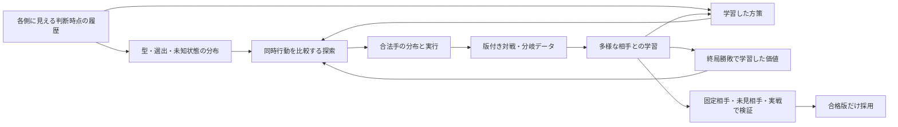

# 勝敗を目的に学習・探索・構築を改善する次期設計

戦術実装後の調査を[弱さの調査と修正順](weakness-audit-20261015.md)に追記した。`02faed0`では未選出メンバーが探索へ混ざる不具合を再現しており、価値学習や探索量の調整より先に修正する。

2026-10-16のPR化時点では、PR #6・#7・#8はmasterへ統合済み。8原則を反映した継続方策と計画比較は[PR #10](https://github.com/michihitoTakami/poke-sim/pull/10)、選出復元の修正は[PR #9](https://github.com/michihitoTakami/poke-sim/pull/9)として分離した。勝敗価値V_refの学習とrootからの終局比較は後続作業である。

作成日: 2026-10-15。調査対象: master `ad2cf61`、PR #6 `4064ad8`、PR #7 `d443ef9`。以下は実装計画であり、改善効果を実測した報告ではない。提示された10/15 03:37〜17:20の成績はユーザー報告として扱う。本設計の作成ではラダー運用、PRのマージ、既存データ分割を変更していない。

追記: ユーザーから、現行構築を手動で使用し、昨日時点でレート2000弱・チャンピオン級190位程度だったとの報告を受けた。現行構築で高い成績を出せる証拠として扱い、構築変更よりも、その操作者の選出・勝ち筋・バトン時機をbotへ移すことを優先する。実機とShowdownの成績は直接換算せず、それぞれで検証する。

## 1. 推奨する方針

**本命は「勝敗で学ぶ価値・方策」と「情報制約を守った探索」を、多様な相手との終局対戦で繰り返し改善すること。公開リプレイで価値関数を一度学習し、HP評価を置き換えるだけでは完了しない。**

着手順は次のとおり。

1. 当面の本番比較基準を従来方式へ戻す。新方式の全面運用を止め、比較基準を固定する。
2. PR #6・#7を統合可能にし、実験割付・記録・乱数を整える。同時に、特性計算と探索の継続方策の欠陥を直す。
3. ユーザーの8つの判断原則を用いた構築専用の継続方策を比較基準に追加する。公開リプレイでの価値の初期学習と、ローカルで「同じ局面の別の手から終局まで対戦する」データ生成器の開発を並行する。
4. 価値を探索へ接続し、**実際に選ぶ手の優劣と終局勝率**を評価する。通った候補を実戦A/Bへ進める。
5. 現行構築で実績のあるユーザーの選出・勝ち筋・バトン判断を比較基準とし、botとの差を学習と失敗再現へ戻す。最終的には、多様なリーグ対戦→価値・方策更新→独立評価の反復を主開発ループにする。構築変更は必要性が実測された場合の別課題とする。

優先するのは勝率と、強い相手・苦手な構築に対して崩れにくいこと。回復率、短い対戦、探索の深さ、相手行動の的中率は診断指標であり、最適化目標にしない。「絶対に負けない」は隠れた情報・相性・乱数がある対戦では保証できないため、**平均勝率と事前に定めた苦手群の成績の両方**で強さを定義する。

## 2. 今回の報告をどう解釈するか

### 2.1 onの運用縮小は妥当。ただし因果の確定ではない

| 方式 | 勝敗 | 勝率 |
|---|---:|---:|
| shadowで実際に指した従来方式 | 88勝123敗 | 41.7% |
| on | 38勝86敗 | 30.6% |

差は11.1ポイント。独立な二項試行とみなした未調整の近似95%区間は約0.6〜21.6ポイント、プールした二標本比率検定では両側p値約0.044。悪化を疑い、本番の比較基準を戻すには十分な材料である。一方、「偶然ではない」「主因がHP評価だ」とまでは確定しない。方式と時間帯が重なり、平均相手レートが同じでも、自分の開始レート、相手構築、再戦、相手の強さの分布はそろっていない。

回復増加・長期化・低い終局到達率はHP評価の偏りと整合するが、高HP回復がすべて悪手とも限らない。先手回復が連続攻撃を耐える条件を作る場合もある。**「回復を何回減らしたか」ではなく、その局面で攻撃・交代・回復のどれが終局成績を上げるか**を測る。

「123敗のうち60敗が最後にペンドラー」は重大な診断材料。ただし敗戦だけを条件にした割合で、60敗を構築変更で回収できるという意味ではない。ペンドラー選出の全試合を分母に、相手・選出・攻撃役の失い方まで調べる。

手動での高順位の実績を踏まえると、この数字から構築の上限を推定するのは早計である。まず、攻撃役を失う順番、バトンを待ちすぎる/急ぎすぎる判断、受け先・選出の不一致という操作者側の仮説を検証する。

### 2.2 PR #7で確認できたこと

[PR #7](https://github.com/michihitoTakami/poke-sim/pull/7)は、ダメージ、同優先度の行動順、非こだわりの証拠で型候補を更新する。候補48件、観察の尤度に0.02の下限を置き、実際のShowdownのダメージ16乱数を利用している。

| PR #7のshadow期間151戦 | 事後分布による予測対数確率の改善 | 95%区間 |
|---|---:|---:|
| 受けたダメージ | +0.072 | +0.042〜+0.105 |
| 与えたダメージ | +0.085 | +0.047〜+0.126 |
| 行動順 | +0.042 | +0.014〜+0.075 |

これは**次の観察の予測**の改善であり、真の型を同定した精度や勝率改善ではない。30局面での指し直しも、敗戦につながった特定局面の診断であり、勝率の反実仮想評価ではない。

活用方針は「マージ可能にして、独立した実験因子として残す」。初めから本番の既定値を有効にする必要はない。既存の推定は、候補外の型、未公開技の周辺頻度による補完、味方同士の型の相関、観察誤差の累積には限界がある。尤度下限があっても48候補に存在しない型は復元できない。

### 2.3 コード調査から追加すべき論点

| 実装上の事実 | 設計への反映 |
|---|---|
| `PLANNER_SEARCH.rollout=5`は、初手の同時行動後の追加継続回数。交代要求も処理する | 「5ターン先」を実際の経過ターン・判断回数と分けて記録する |
| `deadlineMs=2500`は全世界・全継続方策の一巡後に確認するソフト予算。seeds=1では最初の一巡が常に実行される | 深さ増加を2.5秒以内だと仮定しない。復元・型推定・交代候補を含めた1判断全体の期限を設計する |
| `expectedDamage`はPR #7の`belief.js`と違い、active attacker/target/moveを設定しない | ダメージ照会を共通化し、てんねん等を回帰試験する |
| 継続の`greedy`同士、`tactical`同士だけを平均し、両者に同じ継続方策を使う | 自分の継続方策と相手の継続方策を別に指定する。自分の方策を固定した相手比較を可能にする |
| `tactical`は直接攻撃不能・受け先あり・何らかの正の能力ランクがあれば、積みの判定より先にバトンを選ぶ。通常の積み候補は対象ランク+2未満が条件 | 物理相手への鉄壁の重ね掛けや、十分な鉄壁・瞑想を完成させるユーザーの展開を継続で再現できない。構築専用の継続方策を先に比較する |
| 継続方策は完全な`battle`を受け取り、サンプルした隠れた型・技にもアクセスできる | rootで共通戦略を解いていても、継続が隠れた真値に適応する危険は残る。各側の観測を入力にする |
| `solve_common`は混合戦略を返すが、ラダーは既定で最大確率の1手を選ぶ。`--sample`で抽選できる | 解いた目的と実行する行動を合わせる。argmaxと抽選は別の実験因子にする |
| `terminal`採点は実際の勝利にも0.005/ターンの減点を入れる。`winDecay=0`ではこの項は消えない | 新しい勝敗価値へ接続する際は、終局を厳密に勝+1・敗−1・引分0へ変更する |
| `human.py`の`returns`は勝敗の符号×`0.97 ** 残り判断数` | 既存NPZのreturnsを勝率ラベルとして回帰しない |
| 現行の表示較正は1ターン目の通常判断専用 | 全ターンや探索葉の価値関数へ転用しない |
| 強制交代探索には、交代技後の相手の未実行行動を次ターン開始で近似する箇所がある | バトン・とんぼ等の途中段階を、通常ターンから分離して試験する |

参照: [`advisor.py`](../src/pokesim/live/advisor.py)、[`planner.py`](../src/pokesim/search/planner.py)、[`lookahead.py`](../src/pokesim/search/lookahead.py)、[`lookahead.js`](../services/sim-tools/lookahead.js)、[`human.py`](../src/pokesim/rl/human.py)、[`ladder.py`](../scripts/ladder.py)。

## 3. 到達したい意思決定の構成



現行のrootの共通戦略は維持する。最初から探索全体をMCTSや別のゲーム解法へ置き換えない。まず評価、継続、情報制約、計算予算を直し、それでも長いバトン連鎖などに失敗することを測ってから、観測履歴を共有する多段探索を検討する。

### 3.1 価値の意味を固定する

初期モデルと最終モデルを区別する。

- **V_replay**: 公開対戦の、その後の操作者・相手を混ぜた実績勝敗の予測。初期表現の学習と比較基準に使う。
- **V_ref**: 参照方策`pi_ref`が、その版で定義した相手分布に対して続きを指したときの勝敗価値。探索葉で使う本命。

入力は、その側が判断時に持つ履歴・自分の既知情報・相手の事後分布。出力は`P(win), P(draw), P(loss)`。探索の単位は`u = P(win) - P(loss)`とし、引分を半勝として数えた期待得点に対応させる。勝率と引分率は別々にも報告する。引分を半勝にするのは設計上の初期仕様であり、対象ルールで別の優先順位が必要なら実験開始前に変更・固定する。

終局は実結果の+1/0/−1、途中はV_ref。割引率は1とし、HP差・回復回数・生存数の加点を最終目的へ加えない。状態復元失敗・モデル非対応は、HPへ黙って戻さず、理由付きで参照方策へフォールバックする。深い探索中の処理不能分岐も成功した枝として採点しない。

### 3.2 「負けにくい」を過度な受け身に変えない

現行の`rho`は相手の行動予測を信じる割合と各世界の最悪応答を混ぜる係数であり、推定誤差の確率ではない。全世界の最悪手へ備えすぎると攻める機会を失う。継続モデルの誤りも、rhoを上げるだけでは直らない。

当面は共通戦略の目的を維持し、rhoをdevelopmentで少数候補比較する。将来は、検証済みの相手分布の周囲だけを動かす頑健化を比較対象にする。**型が不明であること、相手行動の予測誤差、探索乱数のばらつき、価値モデルの適用外は別々に記録する。** これらを一つの「自信」で扱わない。

## 4. 直ちに行う改善と、応急処置の扱い

### 4.1 本番の基準を固定する

本番比較の基準Aを、従来方式＋現行構築・選出・方策・相手予測の固定版とする。shadow計算は行動を変えず、期限に収まる範囲で観測用に続ける。追加探索が実際の指し手の遅延やtimeoutへ影響するなら収集率を下げる。

本設計だけを根拠に本番設定を変更しない。実装時は設定ファイルを成果物として残し、変更時刻とhashを記録する。

### 4.2 先に直す探索内の打ち方

`services/sim-tools/lookahead.js`のダメージ照会をPR #7の実装と共有する。照会でシミュレータの状態やPRNGを進めないよう、分岐のコピーか状態・乱数の退避復元を契約に含める。平均ダメージだけで倒せると判定せず、必要なところでは乱数幅・命中・優先度・素早さを使う。

継続方策へ、どくどく・あくび・おにび・アンコール/挑発・解除/流し・自主交代・バトンを追加する。効果の有無はシミュレータで確認し、無効相手への一律使用や、受け先不在のバトンを避ける。これは本番用に永久の手作り評価を増やす計画ではなく、現在欠落している脅威を再現する短期策と、リーグ用の対戦相手を作る工程である。

自分と相手の継続を独立指定し、たとえば「自分は参照PPO／相手は妨害方策」と「自分は参照PPO／相手は攻撃方策」を比較できるようにする。greedy/tacticalの対角2通りの平均は主要評価から外す。相手モデルは相手自身の手札を知ってよいが、こちらの非公開手札や、このターンの未公開の選択を見てはいけない。

### 4.3 応急処置は少数候補で比較する

| 提案 | 判断と実験方法 |
|---|---|
| 深さを伸ばす | 単独の第一手にはしない。継続を直した後に、固定試行数で品質を比較し、同じ実時間予算でも比較する。深くしたため型の多様性が失われるなら不採用 |
| HP差の比重を下げる | 一時的な比較候補として有効。ただし0にすると未決着枝の区別まで失う。係数を少数比較し、回復減少だけで採用しない |
| onにPPOを掛ける | 短期の有力候補。ただし現行combineは`defer`により探索が尖ると方策を無視し、marginも旧採点単位。設定をそのまま流用しない |
| HP75%以上の回復を禁止 | 採用しない。必要な回復まで消す。失敗再現と終局成績で個別に評価する |
| V_winを最初に全面導入 | 初期学習はすぐ始めるが、実戦予測の改善だけを根拠に探索へ全面適用しない。分岐対戦での手の順位と適用範囲を先に確認する |

PPOの使い方は、短期は比較可能な混合、次段階では合法手すべてに下限を付けた方策priorを共通戦略の正則化へ使う。例は`J_common(x) - lambda * KL(x || pi_floor)`。lambda=0も必ず比較し、誤った方策から探索が離れられるようにする。既存の混合にある枝の切捨て、defer、温度を一度に全部調整しない。

## 5. 価値学習のデータ設計

### 5.1 手元の量を正しく数える

調査時の`data/processed/scoped/human_replays.npz`は92,291判断・9,877サイド。これは9,877独立対戦ではなく、同じ対戦の両視点を含む。`human_records.npz`は895判断・69サイド、勝敗既知850判断で、現在は主に相手側の模倣用に作られている。

一方、台帳manifestの更新時点は03:28で115戦、既存splitはtrain62/development19/calibration23/purged11、test開始は`20261015-032852`。後から集まった約400戦をすべて学習用とみなすことはできない。

すでに敗因分析・PR #6/#7の比較・今回の方針決定に使った試合は、新候補の未見testとして扱わない。旧manifestを上書きしてtestをtrainへ移すのではなく、**次期実験のmanifestを別名で作成し、既閲覧の試合を開発用として明示し、新候補凍結後の将来試合をtestにする。** 旧評価との対応表・重複IDも残す。

### 5.2 専用の勝敗データを作る

`pokesim.value.dataset`を新設し、既存の台帳・分割・prior bundle・観測コードhash検証を再利用する。模倣用NPZをそのまま入力とせず、原ログと判断時requestから勝敗用の行を作る。

最低限の行は以下。

```text
battle_id, side_id, decision_id, observation, known_mask, phase,
outcome(W/D/L), outcome_known, source, sample_weight,
policy_version, opponent_pool_version, team_hash, belief_version,
observation_hash, split_id, engine_version
```

- 通常ターンは両者の行動公開前、強制交代・交代技途中は実際に判断できる別段階。行動不能・技失敗も、価値の局面としては収録する。
- 不明勝敗・不完全な復元は勝敗損失から除く。引分は不明と区別する。対戦を途中で打ち切っただけでは敗北ラベルにしない。
- 勝敗ラベルは割引なし。既存returnsの絶対値をターゲットに使わない。
- 全ターンを独立標本として数えない。1対戦の重みを正規化し、序盤/中盤/終盤を層化抽出する。信頼区間は対戦単位、必要なら相手・時間ブロック単位で再標本化する。
- 両視点、同一リプレイの別ファイル、ラダーログとの重複、派生した分岐局面は同じ分割へ置く。
- 公開リプレイでは自身の正確な型・選出・未使用技も不明なことがある。試合の未来から埋めた推測を確定値にせず、欠損maskを持つ。requestや本当のチームシートで確認できる情報とは分離する。
- 相手の未来の技・選出・実数値を入力やbeliefへ入れない。初期補完に全ログを使う既存処理は、価値用入力の正しさを保証しない。
- レート・source・操作者は分布差の診断に保持する。未来のレートや、敗北を説明するだけのsource shortcutに依存していないかを確認する。

### 5.3 初期学習と採用ゲート

最初は既存の局面特徴と欠損情報を使う小さなモデルで十分。種族・技の表現、状態異常の経過、PP、積み、残り攻撃役、交代先、見せ合い、beliefの要約を扱えるようにする。大きなモデルへの変更は分岐評価で頭打ちを確認してから行う。

比較基準は、訓練集合の一定勝率、HP/生存数等だけの単純モデル、既存PPO criticの適切な較正。指標はlog loss・Brier・較正曲線。全体に加え、序盤、中盤、終盤、毒・あくび、積み、回復、バトン、自構築、未見構築、公開/ラダー/実機を分ける。AUCだけで合格にしない。

**ゲートV1:** 未使用の対戦で単純基準より予測が改善し、自構築・重要局面で大きな過信がないこと。改善の区間と独立対戦数を出す。これは探索採用の十分条件ではない。

## 6. 最重要の追加工程: 別の手の続きを実際に対戦する

### 6.1 なぜリプレイ教師だけでは足りないか

リプレイの勝敗は、実際に選んだ手とその後の双方の判断の結果である。そこから学ぶV_replayは「このボットがこの手の後を指したらどうなるか」と一致するとは限らない。探索は学習範囲外で価値が高く出る局面を探し当てることもある。予測が較正されているだけでは、未選択の回復と攻撃の順位は保証できない。

### 6.2 分岐対戦器の仕様

ローカルのShowdownを実際に進め、判断直前のsnapshotと、各側の観測履歴・beliefを一緒に保存する。原局面はtrain/developmentから取り、真のsnapshotを持たない実戦局面は複数の仮説世界として扱う。仮説世界での評価を、その実戦の真の反実仮想だと呼ばない。

1. 比較する自分の手と相手の同時手を、公開前の同じ情報から選ぶ。
2. その手を実行し、その後は固定したpi_refと複数の固定相手で本当の終局まで進める。
3. 同じ初期世界・乱数列・相手方策を候補間で対応付け、複数seedで勝敗を集計する。乱数の対応は分散を下げる手段であり、各分岐でイベント消費が変わることも記録する。
4. 独立な未学習相手でも同じ比較を行う。型・継続・採点が同じ重い探索だけを「正解」にしない。
5. 同一原局面から作った全枝を同じsplitへ置く。対称な複数枝を独立対戦として区間を狭めない。

終了しない対戦は、エンジンの正式な引分・timeoutと、評価器都合の打切りを区別する。後者が多い局面は保留し、HPで勝敗を代入しない。長期戦を切り捨てて短期戦だけで優劣を決めない。

初期対象は、回復対攻撃、毒/あくびへの居座り対交代、積み対妨害、バトン時機と受け先、攻撃役の温存、ペンドラーだけが残る展開。既知の失敗を厚く集める集合と、通常局面を代表する集合を分ける。

### 6.3 価値の更新ループ

```text
公開リプレイで表現・勝敗予測を初期化
  → 固定した参照方策と多様な相手で終局データを生成
  → V_refを終局ラベルで更新
  → その価値を使った探索候補を独立に評価
  → 合格した探索の分布・終局結果で方策を更新
  → 方策を凍結し、その方策の継続データを追加
```

教師は実際の終局結果を主とする。TD学習を導入しても、旧モデルの予測だけを教師にした循環にせず、終局サンプルで検証する。V_refの版には参照方策と相手プールを紐付ける。方策を更新しただけで、旧価値が新しい継続の勝率を表すとは仮定しない。

探索中の葉は、各側の観測に変換して価値を呼ぶ。未来に公開された情報ではbeliefを更新してよいが、サンプル世界の隠れた真値で更新しない。同じ情報の局面で世界ごとに別の手を使う抜け道を作らない。

### 6.4 探索採用ゲート

**ゲートV2:** 固定した分岐評価で、選んだ手の終局成績を比較する。予測誤差に加えて、手の順位一致、選んだ手と評価用の最良候補との成績差、その差の不確実性を測る。最良候補の決定と成績測定でseedを分け、最大値を拾ったことによる楽観を避ける。

**ゲートV3:** 固定予算のローカル全対戦で基準Aを改善し、妨害・未見構築・強い相手の事前指定群に大きな後退がないこと。その後に初めて前向きの実戦A/Bへ進める。

モデル間のばらつきや学習集合からの距離は、適用外を疑う補助指標であり正確な信頼区間ではない。適用外では追加対戦または参照方策への復帰を選び、HP値や一定の0.5へ切り替えて「逃げれば高評価」の枝を作らない。

## 7. 探索のばらつきと処理時間

### 7.1 再現可能な比較を先に作る

`SearchRequest`に`world_seed`, `chance_seeds`, `continuation_version`, `budget`, `state_hash`を持たせる。現行でも同じseed番号を各枝に使っているため、その仕組みを拡張し、**型サンプリングを含む全体の再現性**を確保する。

オフライン比較では時間打切りを外して試行数を固定する。同一設定・同一seedで結果が再現することと、seedを替えたときの結果のばらつきを別に測る。beliefあり/なしでは共通の一様乱数から各分布の世界を作るなどして比較を対応付け、分布が違うのに同じ6世界を強制しない。

記録は各手の平均、世界数、seed数、継続別結果、失敗数、終局率、価値モデル使用率、実際の配分を含む。推奨手が変わる頻度だけでなく、変わった2手の終局成績差も調べる。ほぼ同等の手の入替えを大きな問題と扱わない。

### 7.2 計算を使う場所を選ぶ

型候補48件と探索世界6件は別物。型推定を良くしても世界を少数しか見なければ効果が消え得る。posteriorの重みに従う層化/低分散サンプリング、重複候補の集約、尤度cacheを使い、実効的な世界の多様性を記録する。

最初に全合法候補を浅く公平に比較し、近接する有力候補と危険な応答へ追加計算を使う。adaptiveに配分した後に従来と同じ単純平均や標準誤差を流用せず、配分と推定方法を一致させる。rootから毒・妨害・交代を単純なダメージ順で落とさない。

1判断全体のwall-clock予算を型推定・復元・探索・価値推論・選択に分け、期限時には完了済みの比較か合法な参照手を返す。未評価枝をゼロ点と扱わない。初期予算は現行の実測p50/p95/p99から決め、2.5秒を絶対視しない。

PythonとNodeは1葉ずつ往復させず、同じ段階の葉をまとめて推論する。まずPython側のバッチ推論を接続し、転送が支配的ならNode側推論形式を検討する。GPU化や並列化の前にプロファイルを残す。

## 8. 実績のある現行構築の使い方をbotへ移す

現行`baton.json`のペンドラーは鉄壁・守る・身代わり・バトンタッチで攻撃技がない。一方、他の5体には少なくとも直接ダメージ技がある。この役割分担をbotが扱えていないことと、構築そのものが弱いことを区別する。ユーザーの手動での高順位を踏まえ、当面は構築を固定し、その使い方の再現を主課題にする。

### 8.1 ユーザーの判断とbotの差を特定する

手動対戦の記録が残る範囲で、判断時点を復元してbotの推奨を比較する。勝ち試合だけでなく負け試合も含め、選出と次の重要判断を対象にする。

| 判断 | 比較・学習したい内容 |
|---|---|
| 選出・先発 | 相手6体に対して、誰を勝たせる計画で3体を選ぶか |
| バトンの準備と実行 | 何段階の積みで十分か、どの妨害が来る前に渡すか、誰が受けるか |
| 攻撃役の保存 | 終盤に必要な1体は誰か、誰なら削らせる/倒させることができるか |
| 回復・攻撃・交代 | HPの維持と、相手に与える積み・毒・交代の機会をどう比較するか |
| 計画の変更 | バトンを断念して直接攻撃する条件、相手の型判明で勝ち筋を変える条件 |

各判断には、手・判断時点の情報・可能なら理由と想定する数ターンの計画を紐付ける。既存の公開リプレイに現行構築の専門的な使い方が十分含まれるとは仮定しない。ユーザーの対戦を専用の模倣学習・選出学習の候補にし、同じ対戦の派生局面を分割間に漏らさない。

ユーザーとの不一致は有用な診断指標だが、一致率だけを最大化しない。ユーザーの手も絶対の正解とはせず、不一致局面を分岐対戦で検証する。また、ユーザーなら続きを勝てる局面でもbotの継続では負け得るため、模倣で初期化した後に、そのbot自身の継続結果で価値・方策を改善する。

### 8.2 ユーザーから提示された8つの判断原則

次はユーザーの基本方針を設計へ写したもの。例外があることも明示されているため、常に強制するルールや勝敗ラベルへ変換しない。「入れる」は選出、直接交代、バトン受け先で実行条件が異なるので、それぞれを区別して評価する。

| # | ユーザーの基本判断 | botが推定・比較する情報 | 最初の再現課題 |
|---|---|---|---|
| 1 | 対面が物理技中心なら、鉄壁を積めるだけ積む | 攻撃分類と型の事後分布、防御ランク、相手の積み・妨害・交代候補、残HP/PP | 安全な物理対面で、鉄壁1回ですぐ渡さず複数回積む展開を再現する |
| 2 | あくび・吹き飛ばしが懸念されるならサーフゴーを入れる | その技を持つ可能性、特性の有効性、受け先のHP、交代/バトン時の実際の処理順 | 妨害を受け続ける居座りに対し、サーフゴーで防ぐ経路を比較する |
| 3 | ドラゴンテールが懸念されるならフラエッテを入れる | 技の所持確率、フェアリーへの無効、相手の他の技、受け先の残HP | 吹き飛ばしとドラゴンテールを同じ「流し」として処理せず、受け先を分ける |
| 4 | アンコールの心配がなければ鉄壁・瞑想をしっかり積む | 未公開技を含むアンコール確率、実際の行動順、挑発/能力リセット等の別の中断手段 | +2を一律の上限とせず、追加の積みから勝ち切る継続を試す |
| 5 | 相手の攻撃で身代わりが割れないなら身代わりを優先する | 作る身代わりのHPとダメージ分布、連続技・急所・身代わりを無視する効果、作成コスト | 単発の平均被ダメージだけでなく、身代わりを残して積み/バトンへつなぐ価値を評価する |
| 6 | 特殊相手には守る・身代わりで時間を稼ぎ、受け先が上を取れる程度でバトンする | 受け先ごとの素早さ、かそくの経過、相手の素早さ分布・優先度・場、稼ぐHP/PPコスト | ペンドラー自身の先手だけで渡す時機を決めず、受け先の行動順を基準にする |
| 7 | 剣の舞を仕掛けそうな相手にはラウドボーンを出す | 型・未公開技・次手の予測、てんねんが適用される条件、弱点技と特殊攻撃の脅威 | 攻撃ランク上昇を正しく扱い、ラウドボーンへの経路を評価する |
| 8 | 相手構築がこちらより遅いポケモンばかりなら無理にバトンしない | 見せ合いと選出候補、各対面の素早さ分布、こだわりスカーフ等、直接攻撃の勝ち筋 | バトン経由と直接攻撃の計画を並べ、バトンを必須の前提にしない |

「物理中心」「アンコールの心配がない」「上を取れる」は、相手の真の型を見て判定しない。PR #7の型事後分布と、技を含めた整合する候補から推定する。とくにPR #7は未公開技を周辺頻度で補う制約があるため、アンコール・流し・剣の舞の脅威を扱うには、技と配分を組み合わせた候補の検証が必要になる。

### 8.3 1手の模倣から、計画を継続できる方策へ

この8原則は複数ターンの計画を含む。「物理相手に鉄壁を重ねる」「特殊相手に素早さを確保して渡す」「妨害に応じた受け先へ渡す」「バトンせず攻撃する」を構築専用の計画候補として持たせる。それぞれに開始条件、次の候補手、目標、終了/中断条件を定義する。

毎判断で、相手の新しい技や交代を観測して計画を再評価する。計画があるからといって、相手が特殊技やアンコールを見せても鉄壁を続ける実装にしない。中断時には他の計画と通常の合法手へ戻れるようにする。

初期実装は、この原則を反映した自分用の継続方策を追加し、相手の妨害方策と独立に組み合わせる。rootの共通戦略は維持する。各計画の途中経過だけで打ち切る短い評価に加え、バトン後の受け先の行動や攻撃開始までを確認できる比較を設ける。計画を長く実行しても、将来の公開情報を現在知っている扱いにはしない。

この方策は、対戦可能な比較基準・模倣の初期教師・失敗fixtureの生成源として使う。鉄壁や身代わりの使用回数に報酬を与えず、実際の終局勝敗で計画の良し悪しを評価する。学習モデルは例外を学び、原則を上回る手も選べるようにする。物理/特殊型、妨害の有無、素早さ関係を変えた対照局面を作り、8原則に対応する各局面で判断が適切に切り替わることを検証する。

### 8.4 構築変更は必要性を切り分ける追加実験

現行構築での選出・判断改善を主実験とする。ペンドラー非選出は特定相手への選出候補として比較できるが、一律に禁止しない。攻撃技を持つ型・代替構築は、対象環境の違いや再現できない戦術上の制約が実測された場合に比較する。

変更時は対象フォーマットの合法性を確認し、対応する方策・価値・選出モデルを適応させる。既存方策を別構築へそのまま流用して構築の優劣を決めない。ペンドラー単独残り率は勝敗双方で数え、攻撃役が落ちた直前の判断、バトン成功後の勝率、選出別勝率、対妨害性能も記録する。非攻撃役の最後の1体を即敗北と採点しない。

選出表は操作者の版とセットで再生成する。選出モデルが旧方策の勝率を予測し、実際は新探索が指す状態を放置しない。

## 9. 本当に強くなったかを判定する実験

### 9.1 実戦の割付

現行`--policy`複数指定は方策だけを交互に切り替える。planner・belief・構築を含む**対戦パッケージの割付**へ拡張する。

- 対戦開始前、選出を決める前に割付を固定する。相手を見て良さそうな方式へ切り替えない。
- 単純な時間順のA期間/B期間をやめ、短いブロック内でA/Bの順序を乱数化して数をそろえる。割付seedと途中再開状態を保存する。
- 自分/相手の開始レート、相手ID、時刻、構築、再戦を記録する。同一アカウントのレートは両方式の履歴の影響を受けるので、ランダム化しても完全に同条件にはならない。
- 一次指標は事前に固定した対戦得点・勝率差。レート推移、強敵群、時間帯・再戦を考慮した分析は補助とする。元の勝敗数も必ず示す。
- timeoutや例外で負けた試合を除外しない。サーバー障害等の除外規則は実験前に固定する。
- argmax/抽選、型推定、価値、構築を一度に変更しない。最終パッケージの比較とは別に、因子を一つずつ確認する。

混合戦略を実行する版では分布から抽選する。基準版も同じ実行方式にそろえた対照を設け、抽選への変更だけで改善した可能性を分離する。抽選ありの版は、各合法手の正規化後の実行確率を丸めず保存する。既存のargmax記録に出ている推奨確率を、その手の実行確率とみなして重要度補正しない。

### 9.2 最小限の比較順序

1. **基準A対、修正探索＋PPO priorの候補B。** beliefは両方off。ローカルで候補を一つに絞ってから実戦へ進める。
2. **採用した操作者でbelief off/on。** PR #7の貢献を単独で測る。相互作用が疑われる場合に限り、ローカルで操作者×beliefの2×2を追加する。
3. **同じ探索・継続で旧評価対V_ref。** PR #7の有無をそろえ、葉の価値の寄与を測る。基準Aとの全体比較も残す。
4. **現行構築で、ユーザーの判断から学習した版との比較。** 選出・バトン・攻撃役保存の改善が終局成績に結びつくか測る。構築変更は必要性が認められた場合の追加実験にする。

これは実験の切分け順であり、V学習とユーザーの判断差の分析をこの順番で待たせるものではない。PRごとに全組合せのラダーA/Bを行うのも避ける。

### 9.3 必要な対戦数と採用基準

独立試行、両側5%、検出力80%、両群同数の正規近似では次の規模になる。基準42%の仮定であり、再戦・ブロック依存・多重比較がある実験の保証値ではない。

| 検出したい改善 | 必要数の目安/群 | 総25戦/時の場合の合計時間 |
|---|---:|---:|
| 42%→52% | 約390 | 約31時間 |
| 42%→47% | 約1,550 | 約124時間 |
| 42%→45% | 約4,286 | 約343時間 |

400戦/群は10ポイント級の差を調べる規模であり、数ポイントの改善を安定して判定できる規模ではない。実戦前にローカルで候補を減らす理由はここにある。ローカルの対戦生成速度は測定してから総予算を決める。

実験開始前に、比較候補・一次指標・標本数/逐次法・停止規則・実用上の改善幅・許容悪化幅を登録する。初期仕様案は、全面採用では勝率差の95%区間下限が0を超え、点推定+3ポイント以上とする。主要苦手群は訓練・開発データから事前指定し、群ごとの許容悪化幅は初期案で5ポイント、差の片側95%下限が−5ポイントを上回ることを求める。群が複数ならその検定数も事前に扱いを決める。+3ポイントの改善や群ごとの条件を判定する試験数を確保できなければ「未確定」とし、改善や安全性を断定しない。

少数のカナリア対戦は障害・大幅悪化を早く見つける用途に限定する。例外・合法手エラーの即停止条件と、途中の成績を見るための統計的な停止規則を別に定める。毎時間通常のp値を計算して良く見えた時点で採用しない。苦手群の独立試合が足りなければ、その群の安全性は未確認と記録する。

## 10. 実装をPRへ分ける

以下は作業単位の名称であり、既存のPR番号ではない。

| 作業単位 | 主な変更箇所 | 完了条件・依存 |
|---|---|---|
| A: 統合と再現実験 | PR #6/#7、`scripts/ladder.py`、`runtime/bundle.py`、評価記録 | 競合解消、既知の`test_calibration.py`のimport失敗も解消、版固定・対戦単位の設定割付・実行確率記録。既定の有効化は別判断 |
| B: 継続とメカニクス | `sim-tools`の共通damage照会、継続方策、観測アダプタ | てんねん等、妨害、交代、バトン途中段階の差分試験と、ユーザーの8原則を反映した自分用継続方策。観測外情報で手が変わらないこと。Aと開発可能 |
| C: 勝敗データとV_replay | 新`value/dataset.py`, `model.py`, `train.py`、既存台帳契約 | W/D/L・欠損mask・漏洩検査・対戦単位の分割、V1を測定。Aのデータ版に依存 |
| D: 分岐対戦とV_ref | 新`evaluation/branch_matches.py`、snapshot/観測保存、終局データ | 固定参照方策×多様な相手で再現可能な終局結果を生成。Bとデータ契約に依存 |
| E: 価値付き探索 | `lookahead.js/.py`、`planner.py`、`advisor.py`、バッチ推論 | 終局±1、途中V_ref、PPO prior比較、実時間と固定試行数の評価、V2/V3を満たす。C/Dに依存 |
| F: 現行構築の専門的判断の学習 | 手動対戦の判断データ、`sim_matchups.py`、方策/選出成果物 | ユーザーとbotの選出・バトン・攻撃役保存の不一致集合、模倣候補、分岐対戦での検証。A/Bと並行して準備 |
| G: 前向き実戦 | パッケージ設定、割付runner、集計 | 凍結した候補一つと基準Aを比較。新規testのみで採否判断。E等の合格候補に依存 |
| H: 継続的な強化 | 既存`train.py`, `train_opponent.py`, `opponents.py`、価値/方策更新 | 旧版・対抗学習・妨害・独立相手の成績行列を更新し、新候補は毎回同じゲートを通す |

A/Bでは修正箇所の既存試験と意味のある回帰試験を実行する。C/Dは分割の交差、ラベル意味、欠損、両視点の同一分割、snapshotの再現を試験する。Eは終局と途中の尺度、未知情報の隔離、期限時の合法手復帰を試験する。テスト合格を対戦の強さの証明と混同しない。

### 10.1 最初の着手パッケージ

最初に具体化すべき成果物は次の5点。

1. 基準Aと実験割付の設定ファイル、次期manifest、既閲覧データの一覧。
2. PR #7を含む統合版、`expectedDamage`の共通化、ユーザーの8原則に対応する継続方策・回帰fixture。
3. 毒/あくび・高HP回復・バトン・攻撃役消失について、別の手から終局まで比べるローカル評価セット。
4. 生の勝敗を使うV_replayの学習・評価レポートと、参照方策付きの終局データ生成器。
5. 現行構築でユーザーとbotの判断を比較する仕様、および選出・バトン・攻撃役保存の学習候補。

### 10.2 採用しない進め方

- Vの公開リプレイ予測が改善しただけでonを全面運用する。
- 重い探索の再採点を正解として、同じ評価の偏りを再び学習する。
- 相手の次手top-1だけを延々と改善し、探索内の妨害や終局価値を後回しにする。
- 学習相手を単一の最新self-playへ置き換え、過去版・独立相手・強い対抗方策への成績を測らない。
- 手動での高い成績を無視し、botの敗戦パターンだけから現行構築の上限を決める。
- 公開ラダーで全候補を長時間試し、ローカルで落とせる候補まで実戦へ持ち込む。

既存のリーグ・対抗学習基盤を使い、攻撃・毒/妨害・積み・受け・交代・バトン対策の相手群を保つ。弱点を突く相手を追加する一方、学習に使わない相手群を確保する。参照版を倒すための対抗方策を複数seedで学習し、その攻撃成功率も診断する。単一の近似対抗方策に勝てても、攻略不能や理論上の最悪相手への強さを証明したとは扱わない。固定相手への勝率、未見構築への勝率、事前指定した苦手群の成績、実戦成績をそろえて次版を採用する。

## 11. 関連資料

- [既存の対人戦改善設計](competitive-improvement-design.md): 全体の背景と観測・データ契約。本書は次の実装順と採用条件を具体化する。
- [オフラインデータ契約](offline-data-contract.md)、[状態復元契約](state-restoration-contract.md): 再利用する基盤。
- [PR #6](https://github.com/michihitoTakami/poke-sim/pull/6): shadow分析。採点し直しの限界と、既閲覧testの扱い。
- [PR #7](https://github.com/michihitoTakami/poke-sim/pull/7): 型推定と観察予測の改善。参照した設計は同PRの`docs/set-inference.md`。
